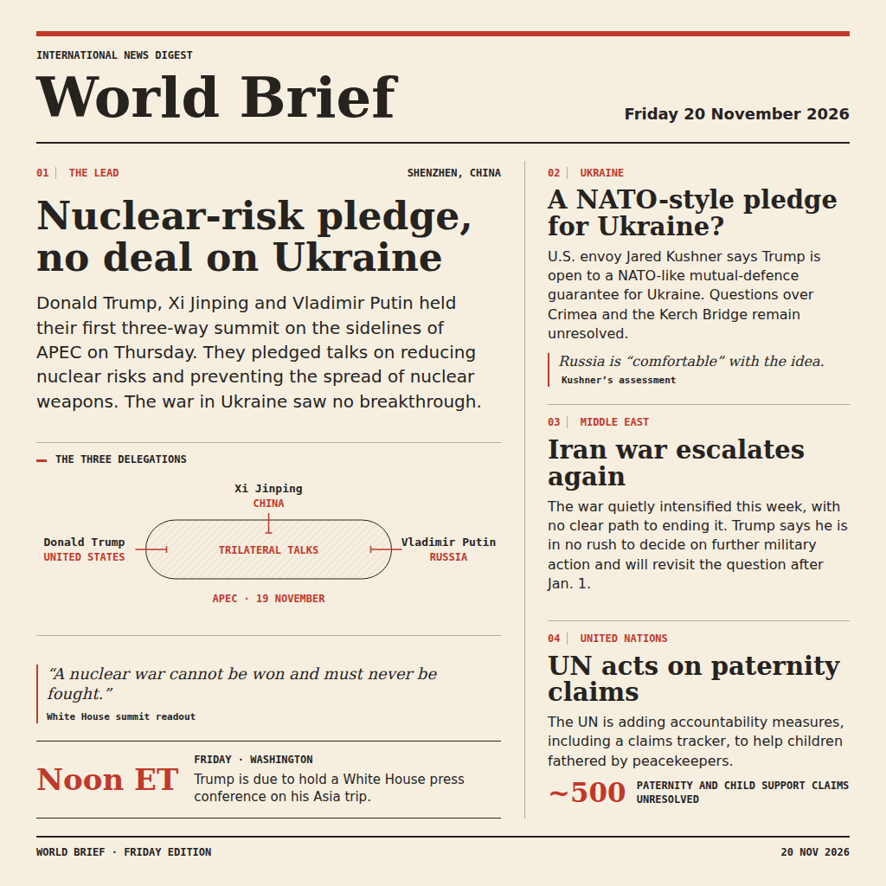

# Sum up 20 November 2026 world news in one image

[](https://make.fun/bounty/news-image-20261120?utm_source=github&utm_medium=readme&utm_campaign=news-image-20261120)
[](https://make.fun/bounty/news-image-20261120/leaderboard?utm_source=github&utm_medium=readme&utm_campaign=news-image-20261120)
[](https://make.fun/bounty/news-image-20261120?utm_source=github&utm_medium=readme&utm_campaign=news-image-20261120)

**World Brief** is a 1024×1024 newspaper front page. The Shenzhen summit leads in a wide left column, with three shorter reports stacked on the right. Warm cream paper, charcoal type and a single red accent set the hierarchy; short pull-quotes and a separate noon briefing keep the key details easy to find. The page uses local fonts and an inline illustration, so it renders without network assets.



## Reporting

- Summit and press conference: [Ghana Broadcasting Corporation](https://www.gbcghanaonline.com/world/trump-wraps-up-historic-summit-with-xi-and-putin-in-china/2026/) and [NBC News](https://www.nbcnews.com/politics/trump-administration/live-blog/trump-xi-putin-nuclear-ukraine-congress-2026-live-updates-rcna610150).
- Ukraine's proposed security guarantee: [Associated Press](https://apnews.com/live/trump-xi-putin-china-politics-news-updates-11-19-2026).
- Iran escalation and Trump's timetable: [Fortune](https://www.msn.com/en-us/news/other/as-attention-spans-move-on-from-iran-and-oil-the-world-is-forever-changed-and-the-conflict-is-escalating-again/ar-AA2hPqjZ) and [Reuters](https://www.reuters.com/world/trump-says-us-will-see-what-happens-conflict-with-iran-after-january-1-2026-11-19/).
- Peacekeeper paternity and child support: [UN News](https://news.un.org/en/story/2026/11/1168842).

## Render

With Python 3, install Playwright and its Chromium browser, then regenerate `entry.png`:

```sh
python3 -m pip install playwright
python3 -m playwright install chromium
python3 render.py
```
